# Superstore Sales Analysis

A Microsoft SQL Server project covering database setup, CSV ingestion, exploratory SQL, dimensional modelling, and business-focused sales and profitability analysis. This repository is based on the accompanying report by Dumoteyim Abiye-Suku and preserves all 17 images and all 16 SQL code blocks embedded in the original article.

**Source report:** [SUPERSTORE SALES ANALYSIS — Medium](https://medium.com/@dumoaby/superstore-sales-analysis-52dbe6710270)  
**Database platform:** Microsoft SQL Server / T-SQL  
**Dataset:** Superstore transactional CSV (not included in this repository)

## Project overview

The workflow starts by creating a dedicated `SuperstoreDB` database and importing a Superstore CSV file into `dbo.Superstore` through SQL Server Management Studio’s Import Flat File workflow. The imported transaction table contains order and shipping details, customers, product attributes, geographic fields, sales, quantity, discount, and profit. The analysis then explores the source table and derives four descriptive dimensions: date, product, customer, and location.

The central transaction table acts as the fact-like table. The dimensions support grouping and filtering by time, products, customer segments, cities, states, and regions. SQL examples then investigate profit margin, sales and profit by product category, annual sales, city sales, average transaction sales by segment, top customers, and product sales and profit rankings.

The report describes the analytical workflow and includes screenshots of the original SQL work and query output. It does **not** provide the numeric result sets as text. Consequently, this repository does not claim which year, product, customer, category, or city performed best; those values must be verified by running the queries against the relevant data.

## Repository contents

- [`sql/superstore_sales_analysis.sql`](sql/superstore_sales_analysis.sql) — all 16 SQL code blocks from the article, in their original order and with their original expressions and naming. It includes database creation, dimension-table creation, and the analytical queries.
- [`images/`](images/) — all 17 original images embedded in the Medium report, saved locally and referenced below. [`images/IMAGE_SOURCES.md`](images/IMAGE_SOURCES.md) records their Medium CDN source URLs and captions.
- This README — project description, setup instructions, explanation of analyses, interpretation notes, and practical data-quality cautions.

## Data model

The report creates dimensions using `SELECT DISTINCT ... INTO`. These statements copy unique combinations of selected source fields into new tables. The resulting entities and report fields are:

- **`DimDate`** — `Order_Date`, `Year`, `Month_Number`, `Day_Number`, `Month_Name`, `Day_Name`, `Month_Short`, and `Day_Short`. The report derives calendar fields with `YEAR`, `MONTH`, `DAY`, `DATENAME`, and `LEFT`.
- **`DimProduct`** — `Product_ID`, `Product_Name`, `Category`, and `Sub_Category`.
- **`DimCustomer`** — `Customer_ID`, `Customer_Name`, and `Segment`.
- **`DimLocation`** — `Country`, `City`, `State`, `Postal_Code`, and `Region`.

The source transaction table is `dbo.Superstore`. The report joins transactions to dimensions using `Order_Date`, `Product_ID`, and `Customer_ID`; its geographic queries use city or state. Although the arrangement resembles a star schema, the original `SELECT INTO` statements do not define primary keys, foreign keys, indexes, or a dedicated surrogate location key.

## Getting started

1. Open SQL Server Management Studio and create or select a SQL Server instance where you can create databases.
2. Run the database creation statement at the start of [`sql/superstore_sales_analysis.sql`](sql/superstore_sales_analysis.sql), or select the `SuperstoreDB` database if it already exists.
3. Import the source CSV into the database and name the imported table `dbo.Superstore`. Confirm the column names and SQL data types, especially `Order_Date`, `Sales`, and `Profit`.
4. Run the four dimension creation statements once. They use `SELECT DISTINCT ... INTO`, so they create new tables and will fail if those tables already exist. For a repeatable workflow, drop or rebuild the dimensions intentionally before rerunning, or replace the source statements with explicit `CREATE TABLE`/`INSERT` logic.
5. Run the analytical queries and inspect the result sets. Validate the joins and totals before using results to make business decisions.

The raw CSV is not included here. Provide your own authorized copy of the dataset before executing the queries.

## Analyses in the SQL file

### Product profit margin

The report demonstrates a row-level calculation of `(Profit / Sales) * 100`. Its original expression is retained. If adapting it for production analysis, use decimal arithmetic, protect against zero sales, and calculate product margin from aggregated profit divided by aggregated sales. An average of row-level margins can differ from the overall margin.

### Sales and profit by product category

The query joins transactions to `DimProduct`, sums sales and profit, groups by category, and orders categories by total sales descending. Looking at profit beside sales helps avoid treating revenue as a complete measure of financial performance.

### Annual sales

The query joins transactions to `DimDate`, sums sales by year, and sorts from highest to lowest. To identify actual growth or decline, inspect the values in chronological order rather than relying only on the ranking.

### Sales by city

The query groups total sales by city and rounds the sum to two decimal places. The report joins on `City` alone. City names may not be unique across states or countries, so a city-only join can match a transaction to multiple dimension records and inflate totals. Validate uniqueness or join on a reliable composite/surrogate location key.

### Average sales by customer segment

The query calculates average transaction-row sales by segment. This is not average customer spending, average order value, or customer lifetime value. For those questions, first aggregate at the appropriate order or customer grain and then calculate the desired statistic.

### Customer and geographic rankings

The queries rank the highest-spending customer overall, customers in Los Angeles, and the top three customers in Texas. The city-only and state-only joins used in the article can duplicate transaction rows where city or state values are not unique. Validate the joins before interpreting these rankings.

### Product rankings

The SQL calculates the five products with the highest total profit, the five products with the highest sum of sales, and the three products with the lowest sum of sales. The report’s labels `Price` in the latter two queries refer to aggregated sales value, not a product’s unit or list price. Low sales alone do not show that a product is unprofitable or should be discontinued; availability, time on sale, margin, inventory, and demand context matter.

## Validation and known limitations

The Medium report is explicit that its script defines analyses but does not include their returned results. Run the queries to obtain figures before adding any quantified conclusions. Also consider the following before relying on the outputs:

- **Geographic join duplication:** joining by city or state alone can create many-to-many matches. Prefer a validated location key or use a checked combination such as country, state, city, and postal code where appropriate.
- **Dimension uniqueness and relationships:** `SELECT DISTINCT` makes combinations unique only for the selected columns. It does not by itself enforce a key, referential integrity, or one-to-one matching from the fact rows.
- **Margin arithmetic:** integer or low-precision arithmetic and zero denominators can produce inaccurate or failed calculations. Use explicit decimal conversion and `NULLIF` for safe division.
- **Measure naming:** `SUM(Sales)` is cumulative sales value, not `Price`. Name measures accordingly to prevent misinterpretation.
- **Aggregate grain:** row average, order average, and customer average answer different questions. Aggregate to the intended grain first.
- **Repeatability:** `SELECT INTO` table creation is not idempotent. Existing dimension tables must be handled before rerunning.
- **Result validation:** compare aggregate totals with the source data, and check for nulls, duplicate records, unexpected values, unmatched keys, and dropped rows.
- **Date dimension lifecycle:** the report’s discussion calls out a `DROP dbo.DimDate` statement in the supplied script and warns that dropping the table before dependent analytical queries will make those queries fail. Keep cleanup separate from the main run sequence.

## Original report images

All 17 images below are the actual images embedded in the Medium report, not recreated or substituted. They are included as local repository assets.

### Exploration and dimensional model

**Data Exploration**

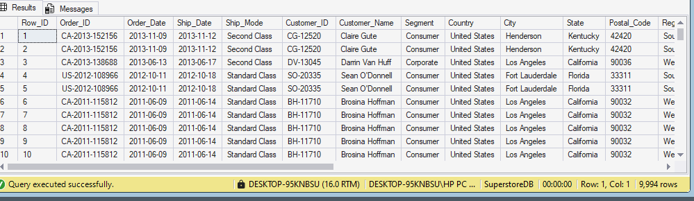

**Data Modelling**

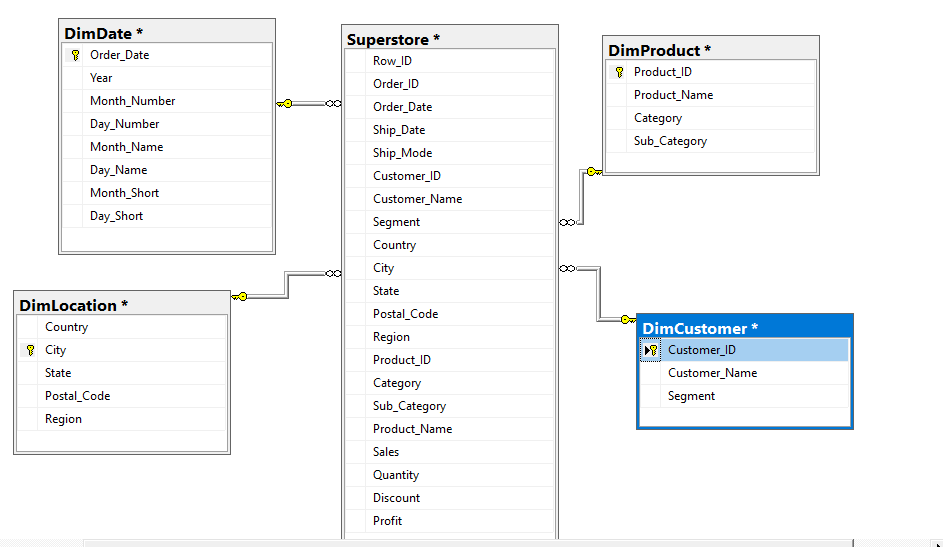

**DimDate**

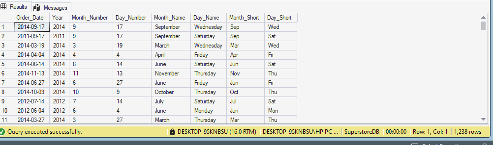

**DimProduct**

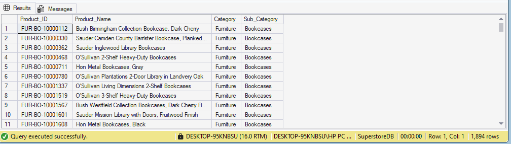

**DimCustomer**

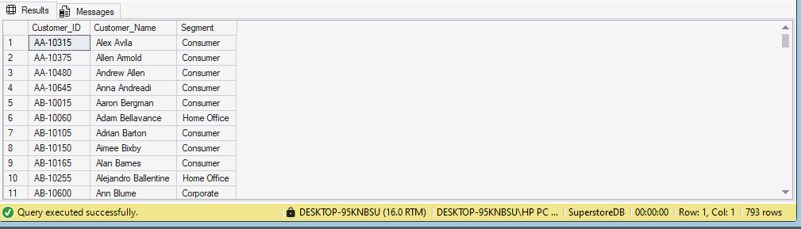

**DimLocation**

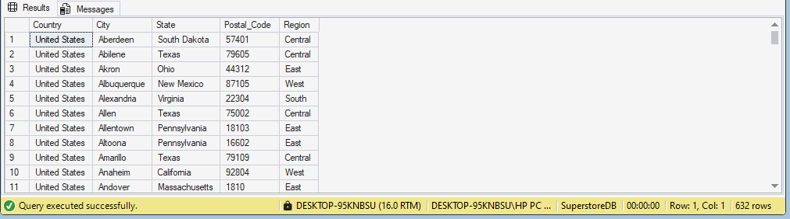

### Analysis screenshots

**Profit margin**

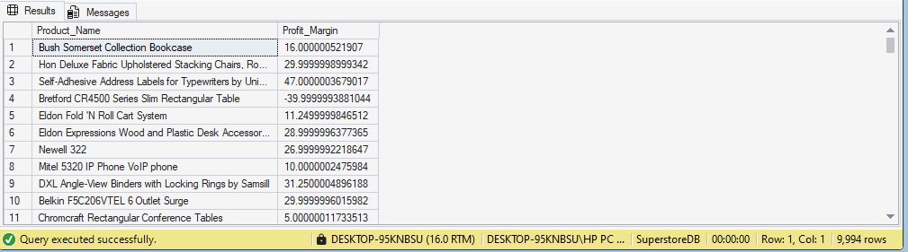

**Sales and profit analysis**

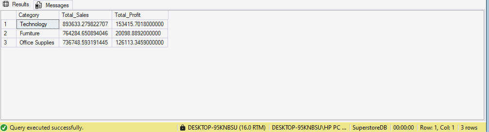

**Annual sales**

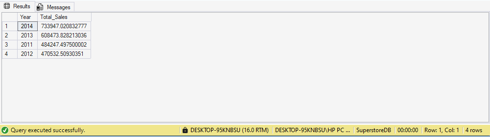

**Sales records**

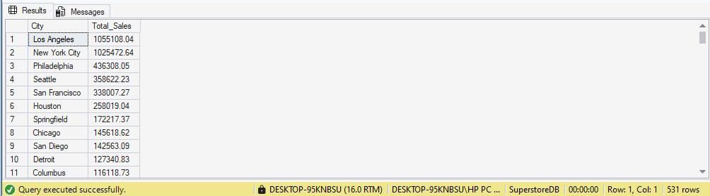

**Average sales**

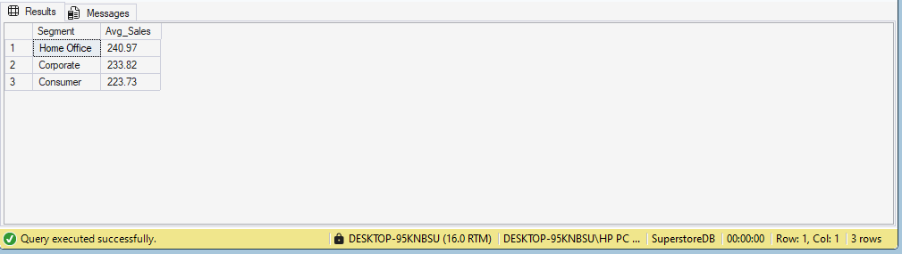

**Highest customer**

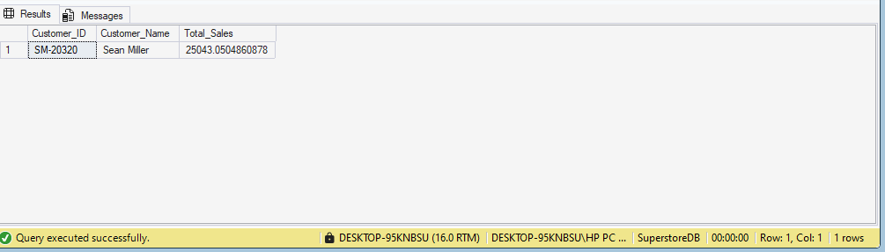

**Los Angeles analysis**

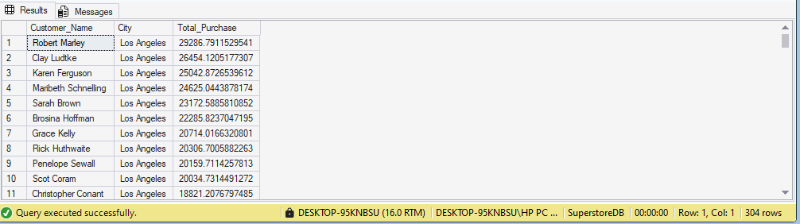

**Most profitable products**

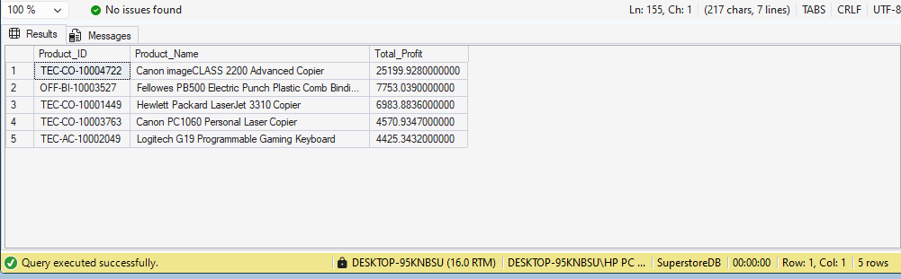

**Texas analysis**

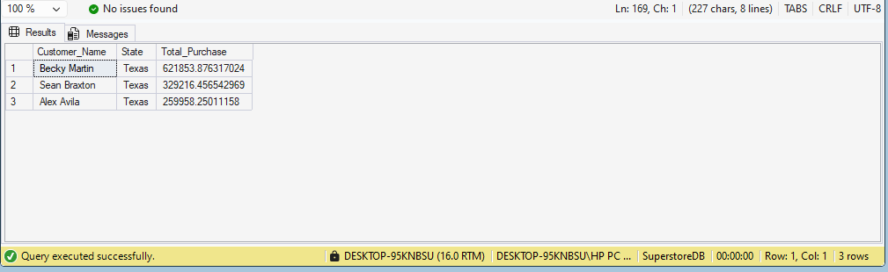

**Top five products**

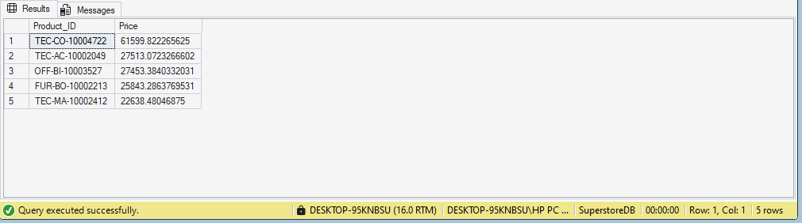

**Three lowest-sales products**

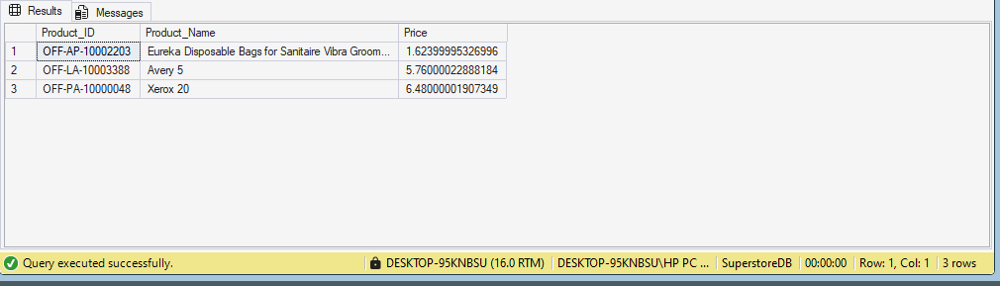

## Source and attribution

This project documents and republishes code and images from [Dumoteyim Abiye-Suku’s Medium report](https://medium.com/@dumoaby/superstore-sales-analysis-52dbe6710270). The image source URLs are listed in [`images/IMAGE_SOURCES.md`](images/IMAGE_SOURCES.md). Refer to the original author and article when sharing or reusing report material.
